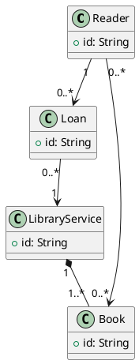
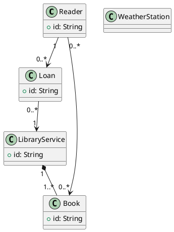

# Semantic failure observations and pending independent validation

## M11_2: first-class retained failure

Raw files: `backend/evaluation/results_v4/test-frozen-20261022/cases/C7_M11_2_1.json` through `_5.json`; first case SRS line 4, output line 27, Critic flag line 32, raw response in trace. Verify with `python -m pytest -q tests/test_closure_regressions.py`.

The SRS specifies Reader, Loan, LibraryService and Book. WeatherStation appears in neither SRS nor gold; it is an injected D2 class. All five C7 outputs keep it unchanged. TP=4 classes, predicted=5, reference=4, precision=4/5, recall=1, F1=2*4/(5+4)=8/9. Typed relationships remain exact for this case. Critic returns `{"is_valid":true,"errors":[],"categories":[]}`, zero repair attempts, termination `accepted`; compiler/project flags are also true. In this case, five runs repeat one failure scenario rather than five independent semantic examples.

Gold:

Frozen C7 output (repeat 1; identical retained class error in all five):

Diagnosis: the parser detects WeatherStation; this is not a missed declaration. The compiler/project predicates check syntax/project rules, not complete SRS grounding. Retrieved rules do not prove every class is licensed by the SRS. Critic agreement is therefore the failed source-grounding signal, and the acceptance conjunction lacks an independent semantic gate. The trace alone cannot separate model-rubric, retrieval and reasoning causes. Status **OPEN**. No prompts, gold, agent or test outputs were tuned from this case.

## Base rates and other deviations

The table defines *exact* as class and directed typed-edge F1 both equal to 1 under `gold-structural-v2`. It excludes multiplicity/attribute disagreement and is not a natural-language semantic truth label. `critic_true_deviation` is a structural false acceptance proxy; `critic_false_exact` is a structural false rejection proxy. C3/C4 have no Critic: their nulls must not be interpreted as rejection. C0–C2 are once per case, C3–C7 repeat five times; all denominators are shown. Shared has no gold and is excluded, never presumed exact.

| Dataset | Condition | Runs / distinct cases | Exact class+typed graph | Deviations | Critic true: exact / deviating | Critic false: exact / deviating | Accepted deviating |
|---|---|---:|---:|---:|---:|---:|---:|
| pure | C0 | 10 / 10 | 10 | 0 | 0 / 0 | 0 / 0 | 0 |
| pure | C1 | 10 / 10 | 10 | 0 | 0 / 0 | 0 / 0 | 0 |
| pure | C2 (exploratory) | 10 / 10 | 10 | 0 | 0 / 0 | 0 / 0 | 0 |
| pure | C3 | 50 / 10 | 50 | 0 | 0 / 0 | 0 / 0 | 0 |
| pure | C4 | 50 / 10 | 50 | 0 | 0 / 0 | 0 / 0 | 0 |
| pure | C5 | 50 / 10 | 14 | 36 | 0 / 9 | 14 / 27 | 9 |
| pure | C6 | 50 / 10 | 41 | 9 | 41 / 6 | 0 / 3 | 6 |
| pure | C7 | 50 / 10 | 48 | 2 | 48 / 2 | 0 / 0 | 2 |
| semantic | C0 | 40 / 40 | 12 | 28 | 0 / 0 | 0 / 0 | 0 |
| semantic | C1 | 40 / 40 | 12 | 28 | 0 / 0 | 0 / 0 | 0 |
| semantic | C2 (exploratory) | 40 / 40 | 12 | 28 | 0 / 0 | 0 / 0 | 0 |
| semantic | C3 | 200 / 40 | 148 | 52 | 0 / 0 | 0 / 0 | 52 |
| semantic | C4 | 200 / 40 | 164 | 36 | 0 / 0 | 0 / 0 | 36 |
| semantic | C5 | 200 / 40 | 7 | 193 | 0 / 2 | 7 / 191 | 2 |
| semantic | C6 | 200 / 40 | 105 | 95 | 77 / 23 | 28 / 72 | 23 |
| semantic | C7 | 200 / 40 | 144 | 56 | 143 / 53 | 1 / 3 | 53 |

Every missing/spurious class and typed-edge deviation, across all reference-bearing main rows, is retained in [SEMANTIC_DEVIATIONS.csv](SEMANTIC_DEVIATIONS.csv) (563 rows), with raw case path, rep and acceptance fields. The graph matching set definitions are `backend/evaluation/reference_metrics.py:35` and `backend/src/utils/plantuml_parser.py:127`; independent primary-metric reparse found no stored-number mismatch.

Additional C7 examples (first repetition only, descriptive):

* `M11_1`: missing classes `[]`, spurious `[]`; missing typed edges `[]`, spurious `[['book', 'reader', 'association']]`. Raw `backend/evaluation/results_v4/test-frozen-20261022/cases/C7_M11_1_1.json`.
* `M12_2`: missing classes `[]`, spurious `[]`; missing typed edges `[]`, spurious `[['appointment', 'clinician', 'association']]`. Raw `backend/evaluation/results_v4/test-frozen-20261022/cases/C7_M12_2_1.json`.
* `M13_1`: missing classes `[]`, spurious `[]`; missing typed edges `[['sender', 'trackingevent', 'association']]`, spurious `[['trackingevent', 'sender', 'association']]`. Raw `backend/evaluation/results_v4/test-frozen-20261022/cases/C7_M13_1_1.json`.
* `M14_1`: missing classes `[]`, spurious `[]`; missing typed edges `[]`, spurious `[['course', 'student', 'association'], ['enrollment', 'student', 'association'], ['enrollmentservice', 'enrollment', 'association']]`. Raw `backend/evaluation/results_v4/test-frozen-20261022/cases/C7_M14_1_1.json`.
* `M17_2`: missing classes `[]`, spurious `[]`; missing typed edges `[['driver', 'vehicle', 'association']]`, spurious `[['vehicle', 'driver', 'association']]`. Raw `backend/evaluation/results_v4/test-frozen-20261022/cases/C7_M17_2_1.json`.
* `M19_1`: missing classes `[]`, spurious `[]`; missing typed edges `[['visitor', 'exhibition', 'association']]`, spurious `[['exhibition', 'visitor', 'association']]`. Raw `backend/evaluation/results_v4/test-frozen-20261022/cases/C7_M19_1_1.json`.
* `M22_1`: missing classes `[]`, spurious `[]`; missing typed edges `[['farmer', 'field', 'association']]`, spurious `[['field', 'farmer', 'association']]`. Raw `backend/evaluation/results_v4/test-frozen-20261022/cases/C7_M22_1_1.json`.
* `M22_2`: missing classes `[]`, spurious `[]`; missing typed edges `[['farmer', 'field', 'association']]`, spurious `[['field', 'farmer', 'association'], ['wateringplan', 'farmer', 'association']]`. Raw `backend/evaluation/results_v4/test-frozen-20261022/cases/C7_M22_2_1.json`.
* `M23_1`: missing classes `[]`, spurious `[]`; missing typed edges `[['resident', 'reading', 'association']]`, spurious `[['reading', 'resident', 'association']]`. Raw `backend/evaluation/results_v4/test-frozen-20261022/cases/C7_M23_1_1.json`.
* `M26_1`: missing classes `[]`, spurious `[]`; missing typed edges `[]`, spurious `[['labservice', 'testrequest', 'association']]`. Raw `backend/evaluation/results_v4/test-frozen-20261022/cases/C7_M26_1_1.json`.
* `M26_2`: missing classes `[]`, spurious `[]`; missing typed edges `[['testrequest', 'labservice', 'association']]`, spurious `[['testrequest', 'labservice', 'composition']]`. Raw `backend/evaluation/results_v4/test-frozen-20261022/cases/C7_M26_2_1.json`.
* `M27_1`: missing classes `[]`, spurious `[]`; missing typed edges `[['athlete', 'event', 'association']]`, spurious `[['event', 'athlete', 'association']]`. Raw `backend/evaluation/results_v4/test-frozen-20261022/cases/C7_M27_1_1.json`.
* `M28_2`: missing classes `[]`, spurious `[]`; missing typed edges `[['diner', 'table', 'association']]`, spurious `[['diner', 'table', 'inheritance']]`. Raw `backend/evaluation/results_v4/test-frozen-20261022/cases/C7_M28_2_1.json`.
* `M29_1`: missing classes `[]`, spurious `[]`; missing typed edges `[]`, spurious `[['claim', 'policyholder', 'association']]`. Raw `backend/evaluation/results_v4/test-frozen-20261022/cases/C7_M29_1_1.json`.
* `P03`: missing classes `[]`, spurious `[]`; missing typed edges `[['defectreport', 'reportfilter', 'association']]`, spurious `[['helpdeskuser', 'reportfilter', 'association']]`. Raw `backend/evaluation/results_v4/test-frozen-20261022/cases/C7_P03_1.json`.

## Benchmark validity

`backend/evaluation/semantic_benchmark/scenarios.json`, `cases.json` and `split.json` define 30 scenarios / 60 seeded corruptions, ten defect labels and combined cases. Dev M01–M10 has 20 corruptions; test M11–M30 has 40. The common four-class/four-edge template and parallel SRS wording reduce structural/domain diversity. Co-construction of SRS and reference models can reward prompt/template matching. Scenario splitting prevents exact scenario reuse, not template-level overlap or author-construction bias. PURE-inspired development is not independent external PURE gold.

Semantic C0 already compiles 36/40 and has class F1 0.949603 / typed F1 0.830060. PURE C0 has class/typed F1 1.0 despite compiling only 2/10. Near-ceiling structural starting scores and a source-unrepresentative corruption distribution limit claims. All-output metrics include non-compilers; compiling-only tables are sensitivity analyses, not replacements. Simple name normalization/singularization has no synonym understanding, may collapse names; typed F1 ignores labels/multiplicity and general UML behaviour. Note/compound-arrow live fixtures demonstrate parser boundaries in [LIVE_RUNTIME_CHECKS.json](LIVE_RUNTIME_CHECKS.json).

Gold leakage: runner passes SRS/input/config into generation, gold only to post-hoc reference metrics (`backend/evaluation/run_matrix.py:277`); a sentinel gold test verifies it never reaches model prompts. This establishes this software path, not independent gold authorship, absence of construction bias or absence of unknown model pretraining overlap. Full intermediate SDK request bodies are BULUNAMADI; prompt hashes cannot recover every request field.

## Pending blind expert protocol — NOT EXECUTED

1. Recruit two independent UML/requirements experts who did not author CURE prompts, references or corrections. Names/annotations/agreements: **BULUNAMADI**. Both receive source requirements and a written annotation rubric before seeing model outputs, condition IDs or gold.
2. Independently annotate required/optional/unsupported classes, typed edge direction, whole/part semantics, cardinalities, naming aliases and source-span justifications. Mark ambiguity explicitly; do not force one gold model when multiple interpretations are defensible. Fix candidate universes/mapping rules before calculating agreement; do not calculate inflated kappa over every absent edge in a huge universe.
3. Freeze their separate annotations with hashes before adjudication. Compute raw percent agreement and Cohen's kappa for fixed categorical item decisions (report prevalence and unit); graph-level class/typed-edge F1 and ambiguity counts alongside it. Bootstrap confidence intervals by source document/scenario, not by individual edge. Missing judgments remain missing.
4. A third independent adjudicator resolves disputes using source spans while blind to model conditions; retain pre/post adjudication labels and reasons. Audit alternative acceptable graph mappings. Only then score anonymized/shuffled model outputs and report agreement separately from performance.
5. Expert-validated results may change reference judgments; store a new annotation/evaluation version, never overwrite frozen v4 gold/numbers. Do not invent kappa, annotations or expert endorsements.

## Proposed v5 development and sealed evaluation — NOT EXECUTED / NOT PREREGISTERED

Use the known M11_2 failure only as a development diagnostic. A generic proposed rubric requires source-span support for each class and typed relation and marks unsupported/ambiguous elements for human review; no WeatherStation/Reader/LibraryService hardcoding. Prototype against varied development domains with negative controls. A deterministic text match is not a sufficient semantic oracle. Keep API containment profile separate from scientific method version.

Before a new performance claim, an independent custodian must obtain genuinely new source-disjoint documents and varied gold graphs (not renamings of the four-node template), seal hashes and hold the test split hidden. Include missing/extra classes, endpoint/type/direction/multiplicity defects, combinations, already-compiling negatives and no-defect controls. Select sample size and smallest effect of interest by a documented prospective power/simulation analysis; no fabricated target-power claim here. Freeze prompts, parser/metrics, model snapshot, all controls including C2, costs and rejection criteria using development only; preregister the exact contrast families and source-cluster inference before any new paid test. Evaluate every assigned case, retain failures, use independent gold adjudication, and never selectively rerun M11_2 to present it as new confirmation.
